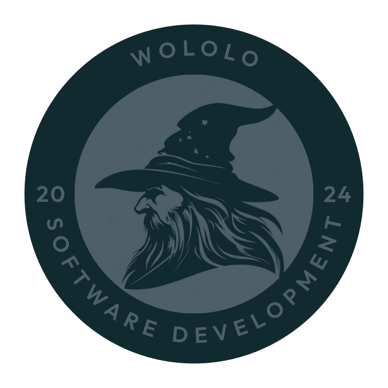

<div align="center">



# Seguridad alimentaria y producción agrícola en Colombia

**Proyecto de Minería de Datos · Grupo Wololo · Universidad de Cundinamarca**


[**🌐 Ver el sitio**](https://mineria-de-datos-4qn5.onrender.com) ·
[🗺️ Hoja de ruta](https://mineria-de-datos-4qn5.onrender.com/entregables) ·
[🎬 Video R6](https://youtu.be/kvMEUs-LW4k)

</div>

---

## ¿De qué trata?

Colombia produce mucha comida y, aun así, muchos hogares no tienen acceso seguro a ella.
Este proyecto usa **datos oficiales abiertos** para entender **dónde, cuánto y con qué
estabilidad** se producen seis cultivos básicos (maíz, arroz, papa, plátano, yuca y fríjol)
y qué patrones explican que algunos territorios rindan menos que otros.

Todo se publica en un **sitio web** donde cada etapa del curso es una sección con sus
gráficos, tablas, filtros, descargas y conclusiones.

| | |
|---|---|
| 📊 **Datos** | EVA · MinAgricultura/UPRA (48.932 registros municipales, 2019–2024) y FAOSTAT · FAO (2000–2024) |
| 🗺️ **Cobertura** | Colombia: 1.098 municipios de 32 departamentos |
| 👥 **Equipo** | Jonathan David Chavarro Segura ([@JODACHSE](https://github.com/JODACHSE)) · Andrés Felipe Rodríguez Correa ([@N3X4N](https://github.com/N3X4N)) |

## Las etapas

| Etapa | ¿Qué se hizo? | En el sitio |
|:---:|---|---|
| **R1** · Del problema a los datos | Pregunta de investigación, fuentes, dataset inicial y primer diagnóstico de calidad. | [`/r1`](https://mineria-de-datos-4qn5.onrender.com/r1) |
| **R2** · Calidad de los datos | Medición de 6 dimensiones de calidad y limpieza documentada de los 4 datasets. | [`/r2`](https://mineria-de-datos-4qn5.onrender.com/r2) |
| **R3** · ETL con SSIS | Limpieza automática con paquetes de SQL Server Integration Services, en tres iteraciones. | [`/r3`](https://mineria-de-datos-4qn5.onrender.com/r3) |
| **R4** · Conocimiento evidente | Cuatro preguntas exploratorias (población, territorio, tiempo y cruces) con informe en Power BI. | [`/r4`](https://mineria-de-datos-4qn5.onrender.com/r4) |
| **R5** · Análisis multidimensional | Modelo estrella y cubo OLAP interactivo (drill-down, roll-up, slice, dice y pivot). | [`/r5`](https://mineria-de-datos-4qn5.onrender.com/r5) |
| **R6** · Conocimiento oculto | Modelos predictivos, grupos de municipios y análisis de comentarios de YouTube en Orange. | [`/r6`](https://mineria-de-datos-4qn5.onrender.com/r6) |
| **R7** | Aún no definida. | — |

## Probarlo en tu computador

Necesitas **Python 3.12** y Git.

```bash
git clone https://github.com/JODACHSE/Mineria-de-Datos.git
cd Mineria-de-Datos
./setup.sh          # en Windows: setup.bat
```

El script crea un entorno virtual, instala todo y deja el sitio corriendo en **http://127.0.0.1:5000** (Ctrl+C para detenerlo).

<details>
<summary>Prefiero hacerlo paso a paso</summary>

```bash
python -m venv .venv
source .venv/bin/activate            # Windows: .venv\Scripts\activate
pip install -r requirements-dev.txt
cp .env.example .env                 # Windows: copy .env.example .env
python run.py
```

</details>

Para correr las pruebas: `pytest` (53 pruebas).

## ¿Cómo está organizado?

La regla es simple: **lo que pertenece a una sola etapa vive en una carpeta `rN/`**;
lo que comparten varias páginas está en carpetas comunes.

```
app/
├── routes/             páginas (pages.py) y API en JSON (api.py)
├── services/           cálculos de cada etapa: reports (R1/R2), etapa3 … etapa6, dw + olap (R5)
├── templates/
│   ├── layouts/        esqueleto de las páginas
│   ├── components/     menú, índice lateral, footer…
│   ├── pages/          inicio, entregables y equipo
│   └── etapas/r1…r6/   una carpeta por etapa
├── static/
│   ├── css/            estilos por capas: tokens → base → layout → components
│   ├── js/             core/ (común) · features/ (compartido) · etapas/rN/ (de una etapa)
│   ├── etapas/r3, r6/  descargas: informes, R3.zip, imágenes
│   └── data/R1…R6/     datos ya procesados que muestra el sitio
├── etapas.py           lista de etapas (título, estado, icono y color)
└── security.py         cabeceras de seguridad
scripts/                programas que generan los datos (R1/R2 en la raíz, R3/, R5/, R6/)
SQL/                    scripts de base de datos (R3 y R5)
orange/                 flujos y datos de Orange (R6) — ver su README
docs/                   documentación técnica (R3, R4 · Power BI, R5)
tests/                  pruebas automáticas
```

> El sitio **no modifica** los datos: solo lee los archivos de `app/static/data/`, que se
> generan con los scripts de abajo.

## Regenerar los datos

Solo hace falta si quieres reconstruir todo desde las fuentes originales.

| Comando | ¿Qué hace? |
|---|---|
| `python scripts/fetch_faostat.py` | Descarga FAOSTAT (necesita `FAOSTAT_TOKEN` en `.env`). |
| `python scripts/rebuild_chart.py` | Rehace los datos de FAOSTAT desde los CSV, sin descargar. |
| `python scripts/process_eva.py` | Prepara el EVA y lo cruza con FAOSTAT (R1). |
| `python scripts/clean_datasets.py` | Aplica la limpieza de calidad (R2). |
| `python scripts/etapa3_iteraciones.py` | Replica en Python las reglas de SSIS (R3). |
| `python scripts/R5/build_star.py` | Construye el modelo estrella en SQLite (R5). |
| `python scripts/R5/export_docs.py` | Regenera la documentación de R5. |
| `python scripts/R6/…` | Pasos de Orange y YouTube: ver [`orange/README.md`](orange/README.md). |

## Detalle por etapa

<details>
<summary><b>R3 · ETL con SSIS</b></summary>

- Proyecto de Visual Studio en [`scripts/R3/`](scripts/R3/) (`EVA.dtsx`, `FAOSTAT.dtsx`). También se descarga como `R3.zip` desde `/r3`.
- Base de datos (esquema y procedimientos) en [`SQL/`](SQL/).
- Explicación de cada paquete: [`docs/R3/Mineria_ETL_EVA.md`](docs/R3/Mineria_ETL_EVA.md) y [`docs/R3/Mineria_ETL_FAOSTAT.md`](docs/R3/Mineria_ETL_FAOSTAT.md).
- Video de demostración: [youtu.be/z8omdqE1M5I](https://youtu.be/z8omdqE1M5I).

</details>

<details>
<summary><b>R4 · Conocimiento evidente</b></summary>

- Cuatro páginas, una por pregunta: `/r4` (poblacional), `/r4/territorial`, `/r4/temporal` y `/r4/relacional`.
- Cada página incluye su informe interactivo de Power BI. El archivo original está en [`docs/R4/EVA_PowerBI_wololo.pbix`](docs/R4/) y se descarga desde la página.

</details>

<details>
<summary><b>R5 · Análisis multidimensional</b></summary>

- **Modelo estrella** en SQLite: una tabla de hechos (producción por municipio, cultivo y periodo) y cuatro dimensiones (territorio, tiempo, cultivo y sistema productivo), con 8 medidas y 4 jerarquías.
- Se eligió SQLite porque viene con Python, es un solo archivo y funciona en Render. La base **no se versiona**: la app la construye sola al arrancar.

| ¿Qué buscas? | ¿Dónde está? |
|---|---|
| Diagrama y diccionario | [`docs/R5/modelo_estrella.md`](docs/R5/modelo_estrella.md) |
| Preguntas, operaciones y conocimientos | [`docs/R5/analisis_multidimensional.md`](docs/R5/analisis_multidimensional.md) |
| Tablas, consultas y validaciones en SQL | [`SQL/R5/`](SQL/R5/) |
| Carga de datos y motor OLAP | [`app/services/dw.py`](app/services/dw.py) · [`app/services/olap.py`](app/services/olap.py) |

</details>

<details>
<summary><b>R6 · Conocimiento oculto</b></summary>

- Tres flujos de Orange en [`orange/flujos/`](orange/flujos/): clasificación (¿el rendimiento será alto o bajo?), grupos de municipios (k-Means) y análisis de comentarios de YouTube.
- Guía completa para reproducirlos: [`orange/README.md`](orange/README.md).
- En el sitio (`/r6`): hallazgos, métricas, diagramas de los flujos, informe en PDF y [video de sustentación](https://youtu.be/kvMEUs-LW4k).

</details>

## API

Los datos también se pueden consultar en JSON:

| Ruta | Devuelve |
|---|---|
| `/api/dataset/<nombre>` | Filas paginadas y filtrables (`qcl`, `qcl_basicos`, `fs`, `eva_basicos`). |
| `/api/quality/<nombre>` | Diagnóstico de calidad de R1. |
| `/api/profile/<nombre>` | Perfil de columnas y 6 dimensiones de calidad (R2). |
| `/api/r5/<vista>` | Consulta OLAP de una vista de R5. |

## Publicación y seguridad

- **Render:** al conectar el repositorio como *Blueprint*, [`render.yaml`](render.yaml) crea el servicio. Comando de arranque: `gunicorn run:app --workers 1 --threads 4 --timeout 120 --preload`.
- **Configuración:** todo valor sensible va en variables de entorno (ver [`.env.example`](.env.example)); nunca se sube a GitHub.
- **Protección:** política de seguridad de contenido (CSP), cabeceras HTTP seguras y cookies protegidas ([`app/security.py`](app/security.py)).

## Fuentes y licencias

EVA (MinAgricultura/UPRA, datos abiertos) · FAOSTAT (FAO, CC BY 4.0) · ENSIN 2015 (ICBF/MinSalud) ·
DANE · World Bank Open Data (CC BY 4.0) · Our World in Data (CC BY 4.0).

Proyecto de **uso académico**.
