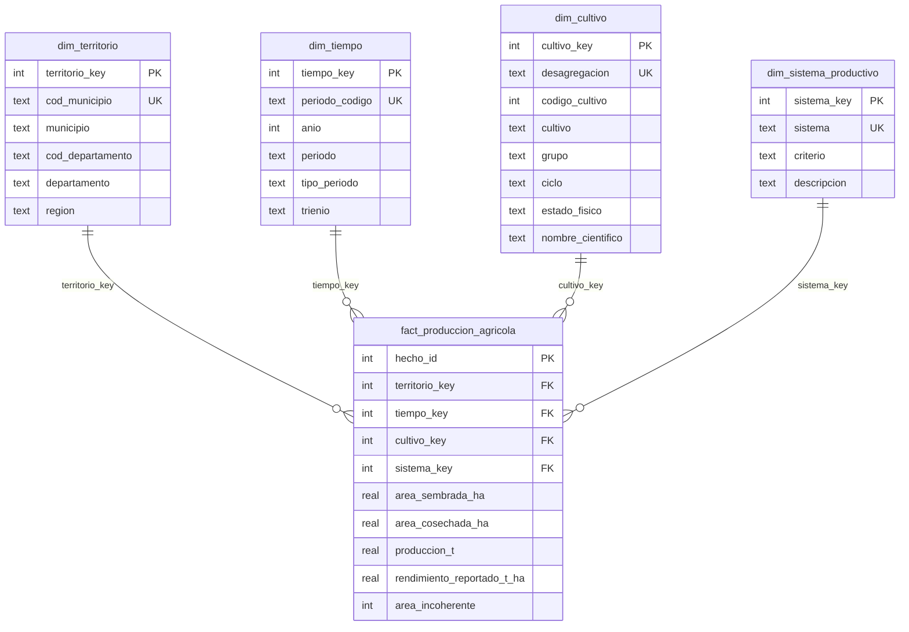

# R5 · Modelo multidimensional — diagrama y diccionario

Data mart en estrella sobre el EVA tratado en R2/R3 (`app/static/data/R2/eva_basicos.json`,
48.932 registros, 2019–2024, 1.098 municipios, 32 departamentos, 6 cultivos básicos).
Implementado en **SQLite** (`app/data/R5/wololo_dw.sqlite`, se genera; no se versiona).

Preguntas, ejemplos de operaciones OLAP, conocimientos y resultados de las validaciones:
[`analisis_multidimensional.md`](analisis_multidimensional.md).

- **Unidad de análisis:** la producción de un cultivo básico en un municipio.
- **Granularidad de la tabla de hechos:** 1 municipio × 1 desagregación de cultivo × 1 periodo agrícola
  (semestre A/B para transitorios; año para el plátano, permanente).

## Diagrama



La restricción `UNIQUE (territorio_key, cultivo_key, tiempo_key)` impone la granularidad. Cada
dimensión tiene el miembro `0 = Desconocido` para claves faltantes (hoy ningún hecho lo usa).

Se distinguen tres casos: **faltante** (medida sin dato → `NULL`, ignorado por `SUM`), **categoría desconocida**
(hecho sin municipio/cultivo/sistema identificable → clave `0`) y **respuesta negativa** (EVA reporta 0, p. ej.
área cosechada 0 = no hubo cosecha → se conserva como 0).

## Dimensiones y jerarquías

| Dimensión | Filas | Atributos | Jerarquía | Justificación |
|---|---|---|---|---|
| `dim_territorio` | 1.098 + Desconocido | cod_municipio, municipio, cod_departamento, departamento, region | Región → Departamento → Municipio | DIVIPOLA: cada municipio en un departamento; cada departamento en una región natural |
| `dim_tiempo` | 18 | periodo_codigo, anio, periodo, tipo_periodo, trienio | Trienio → Año → Periodo | Trienios de igual duración para comparar periodos equivalentes |
| `dim_cultivo` | 16 + Desconocido | desagregacion, cultivo, grupo, ciclo, estado_fisico, codigo_cultivo, nombre_cientifico | Grupo → Cultivo → Desagregación | Cada desagregación EVA pertenece a un cultivo y este a un grupo |
| `dim_sistema_productivo` | 7 + Desconocido | sistema, criterio, descripcion | Criterio → Sistema | Nivel tecnológico (maíz/arroz), destino (plátano/yuca) o sin diferenciar (papa/frijol) |

Mapeo desagregación → sistema: tecnificado = maíz tecnificado (y amarillo/blanco tecnificado), arroz riego,
arroz secano mecanizado; tradicional = maíz tradicional (y amarillo/blanco tradicional), arroz secano manual;
consumo interno / exportación = plátano; consumo en fresco / industrial = yuca; sin diferenciar = papa y frijol.

## Medidas

| Medida | Unidad | Fórmula | Agregación | ¿Se puede sumar? |
|---|---|---|---|---|
| Producción | t | `SUM(produccion_t)` | SUM | Sí, en todas las dimensiones |
| Área sembrada | ha | `SUM(area_sembrada_ha)` | SUM | Sí (al sumar semestres cuenta hectárea-semestre) |
| Área cosechada | ha | `SUM(area_cosechada_ha)` | SUM | Sí |
| Área no cosechada | ha | `SUM(sembrada) − SUM(cosechada)` | diferencia de sumas | Sí (neta) |
| Rendimiento ponderado | t/ha | `SUM(produccion_t) / SUM(area_cosechada_ha)` | cociente | **No**: se recalcula; nunca se promedian rendimientos |
| Tasa de cosecha | % | `100 × SUM(cosechada) / SUM(sembrada)` | cociente | **No**: se recalcula en cada nivel |
| Registros | registros | `COUNT(*)` | COUNT | Sí (conteo de filas, no de entidades) |
| Municipios únicos | municipios | `COUNT(DISTINCT territorio_key)` | COUNT DISTINCT | **No**: los subtotales no se suman |

Las participaciones (%) indican su denominador (total de la selección, de la fila o de la columna).

## Correspondencia de variables y transformaciones

| EVA tratado (R2) | Modelo | Transformación |
|---|---|---|
| CodigoMunicipioDane, Municipio | dim_territorio.cod_municipio, municipio | trim; clave natural → `territorio_key` |
| CodigoDeptoDane, Departamento | dim_territorio.cod_departamento, departamento | sin cambios |
| Departamento | dim_territorio.region | mapeo departamento → región (el de R4) |
| Anio, Periodo | dim_tiempo.anio, periodo_codigo, periodo, tiempo_key | `2019A` → Semestre A (20191), `B` → Semestre B (20192), vacío → Anual (20190) |
| Anio | dim_tiempo.trienio | 2019–2021 / 2022–2024 |
| DesagregacionCultivo, Cultivo, GrupoCultivo, CicloCultivo, EstadoFisico, NombreCientifico, CodigoCultivo | dim_cultivo.* | una fila por desagregación |
| DesagregacionCultivo | dim_sistema_productivo | diccionario 16 → 7 sistemas |
| AreaSembrada, AreaCosechada, Produccion | area_sembrada_ha, area_cosechada_ha, produccion_t | numéricas; faltante → NULL, nunca 0 (no hay faltantes); 0 = respuesta negativa reportada (2.298 hechos sin cosecha) |
| Rendimiento | rendimiento_reportado_t_ha | solo trazabilidad |
| _flag_area_incoherente | area_incoherente | 0/1; atributo degenerado usado como filtro |
| Subgrupo, _outlier_iqr_* | — | no cargados (redundantes / ya tratados en R2) |

## Carga y validación

```bash
python scripts/R5/build_star.py          # crea la base, carga y valida (21 comprobaciones)
python scripts/R5/export_docs.py         # regenera analisis_multidimensional.md desde el modelo
sqlite3 app/data/R5/wololo_dw.sqlite < SQL/R5/02_validaciones.sql
```

La app también construye la base al arrancar si no existe o si el JSON tratado es más reciente
(`app/services/dw.py → ensure`). Scripts: `SQL/R5/01_modelo_estrella.sql` (tablas y relaciones),
`02_validaciones.sql`, `03_consultas_olap.sql` (operaciones y preguntas).

Herramientas: SQLite (incluido en Python, un solo archivo, consultable desde Flask y desplegable en
Render, donde el SQL Server de R3 no está disponible) y Python estándar para el ETL (sin dependencias nuevas).
